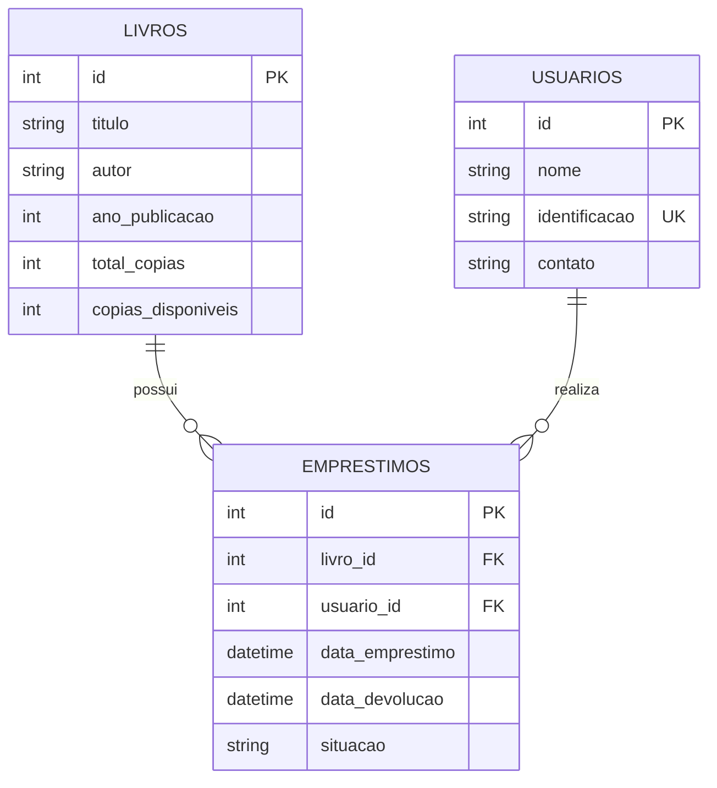

# Biblioteca — Projeto Integrado (Anhanguera)

Aplicação web simples para cadastro de livros e usuários, empréstimos, devoluções, consultas e relatórios. Continua a estrutura inicial enviada para o projeto acadêmico. Não há dados fictícios carregados automaticamente.

## Instalar e executar

No terminal do PyCharm ou do PowerShell, dentro da pasta `Biblioteca`:

```powershell
python -m venv .venv
.\.venv\Scripts\Activate.ps1
python -m pip install -r requirements.txt
python run.py
```

Abrir `http://127.0.0.1:5000` no navegador.

O banco SQLite é criado automaticamente em `instance/biblioteca.db` na primeira execução. Os cadastros persistem entre execuções. Não exclua o arquivo se quiser manter os dados.

Para rodar os testes:

```powershell
python -m pytest -q
```

## Funcionalidades

- **Livros**: cadastrar título, autor, ano de publicação e total de cópias; listar, consultar por título/autor/ano, ver detalhes, alterar ou excluir sem histórico.
- **Usuários**: cadastrar nome, identificação única e contato; listar, alterar ou excluir sem histórico.
- **Empréstimos**: selecionar livro e usuário cadastrados; só confirmar se houver cópias disponíveis; reduzir o estoque.
- **Devoluções**: devolver um empréstimo ativo; atualizar o estoque e bloquear devolução repetida.
- **Relatórios**: mostrar livros disponíveis, empréstimos ativos, usuários cadastrados e histórico.

## Estrutura

```text
Biblioteca/
├── run.py                       # Inicializa o Flask
├── requirements.txt
├── config/settings.py           # Configuração
├── app/
│   ├── __init__.py              # Criação da aplicação
│   ├── extensions.py            # Banco de dados
│   ├── views/                   # Rotas e formulários HTTP
│   ├── controllers/             # Encaminhamento dos casos de uso
│   ├── services/                # Validação e regras dos negócios
│   ├── repositories/            # Consultas ao banco
│   ├── dto/                     # Validação dos campos
│   ├── models/                  # Tabelas do banco
│   ├── templates/               # HTML/Jinja2
│   └── static/                  # CSS e JavaScript
└── tests/                       # Testes de funcionamento
```

## Modelo de dados



## Regras importantes

O total de cópias não pode ser inferior à quantidade atualmente emprestada. Uma devolução não pode ser repetida. As mudanças no empréstimo e na quantidade disponível são gravadas na mesma transação. Livros e usuários com histórico de empréstimos não podem ser excluídos, nem após a devolução, para não quebrar os registros.

As ações de escrita usam `POST` e um token contra envio de formulários por outros sites (CSRF). A chave da aplicação pode ser definida pela variável de ambiente `CHAVE_SECRETA`; se não existir, é criada uma chave temporária a cada execução. A aplicação se destina a **uso acadêmico e execução local**, não a publicação aberta sem controles de acesso e configuração de produção.

## O que ficou fora do escopo

Não foram incluídos login, permissões, prazos de empréstimo, multas, reservas, códigos de barras, envio de e-mails, exportações nem dashboards, pois não fazem parte das funcionalidades exigidas no enunciado. Também não há sistema de migrações: como a base ainda é nova, a criação automática das tabelas foi mantida para simplificar a execução. Alterações futuras no modelo poderão exigir migrações.

O **relatório acadêmico em Word** (capa, introdução, desenvolvimento e conclusão) é uma entrega separada da faculdade, conforme o PDF. O arquivo de código **não o substitui**. O enunciado exemplifica uma interface de console, mas esta versão segue a proposta web Flask do projeto iniciado; em caso de dúvida, confirme com o tutor se a interface web é aceita.
